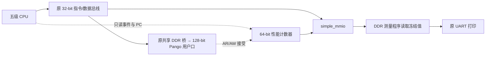

# CPU 性能计数器 2B：MMIO、UART 读出与隔离候选

## 2026-10-18：固定布局PERF27 P/V短应用实板读出已核通过

[最终收据](../../sim/cpu_cache_perf/fixed_layout_20261018_a/board_review_final_01/review.json)核P/V各295应答/唯一RUN、CRC5275/8803、27项/ROI/分类/缓存守恒及完整尾RX。P2.564891488秒、V2.565818762667秒，对原固定BIN仅+0.001892%/+0.000733%，已基本消除移址版开销；I打印均99.88%，D读98.94%/98.98%。固定布局BIN作为后续27项实测入口，原BIN/失败/历史移址日志保持，不重复成功测量。V通过同位流JTAG恢复，KEY0暖复位根因仍未解决；短应用读出PASS不等于完整041+042/复位/IRQ回归或>=10秒正式跑分。

## 2026-10-18：固定布局P完整应用通过，V首PING失败待冷恢复

[本轮实板收据](../../sim/cpu_cache_perf/fixed_layout_20261018_a/board_review_01/review.json)核P295回应/CRC5275/27项/尾RX完整通过，240458577cycles/2.564891488秒，对原固定P仅+0.001892%，固定布局已在P恢复。I打印99.88%、D读98.94%。V仅首条PING超时，无程序装载或运行；原partial RX缺失不补造0RX，KEY0/启动根因未定。只补PC部分RX记录和显式jtag恢复提示，原5秒超时/判据及RTL/BIN保持。下一步保持现有同位流、重新JTAG/KEY0释放，按[EX阶段顶部](ID判定EX重定向实现与指令集回归_2026-10-18.md)V-only命令，不重复P/重做PDS；未扩完整硬件/KEY0 PASS。

## 2026-10-18：PERF27固定布局版消除被测代码/工作区移址，待实测

用户授权布局修复后，新增`build_perf27_fixed.py`/`perf27_fixed_software.py`，直接保留冻结P/V300原text/rodata/data/BSS及86符号地址，旧加载区仅冻结后的perf_dump入口8字节跳转到独立读出。main/iterate/算法热点与static_memblk0x40003ba8保持；独立代码/常量/数据在0x40008000/0x40008bf8/0x400090f0，末尾0x400091d0低于原4KiB栈底0x4000f000。新增计数暂存零初始化装载，不进入原startup BSS清零循环。RTL、读出C语义和27项MMIO合同保持。

新tag=`measure_perf27_fixed_20261018_a`，P/V BIN均37328字节，默认上板入口已切新tag；旧BIN/tag/历史日志保留。加载器发送包含空洞填充的平坦BIN，因此下载较长，统计ROI不包含下载。新审查适配独立段，仍逐代码字ISA白名单/ELF装载字节/原BSS精确地址/段及栈边界检查，不改变输出协议。详见[静态收据](../../sim/cpu_cache_perf/fixed_layout_20261018_a/review.json)与[EX阶段命令](ID判定EX重定向实现与指令集回归_2026-10-18.md)；目前只是静态地址/字节保持及离线schema通过，未执行新BIN，不把原UART重放当新运行证据。用户保持当前位流，无PDS或重建位流需求，待新布局P/V实测再评估性能。

## 2026-10-18：性能比较应使用固定BIN，PERF27布局影响已见实测

本轮同一登记新位流上，旧固定P/V仍2.564842954667/2.565799968秒，与039同BIN只差−2411/−863周期；新PERF27为2.602139744/2.602730677333秒（+1.454155%/+1.439345%）。新增打印发生在ROI外。退休/AW/branch数相同但P AR多135131、MEM多3924095周期；ELF热点函数移1008字节，工作区地址亦变，支持布局/cache映射扰动解释，不能写为计数硬件必然拖慢CPU。详见[比较收据](../../sim/cpu_cache_perf/software_20261018_a/timing_comparison_01/comparison.json)与[EX阶段](ID判定EX重定向实现与指令集回归_2026-10-18.md)。新V完整UART/CRC8803/27项已核；P恢复及尾RX缺项保持。未进行新测量或布局修复，后续需要固定被测地址才可减少软件观察扰动。

## 2026-10-18：首P实板27项已输出，PC大小写解析缺陷已修

首P在`PERF27 extension metadata mismatch`停止，实际UART已含全部27项；BSP`printf`的hex是大写，而新增解析只认小写。只修PC元数据/计数hex域接受A–F与a–f，不改位宽或语义判据，硬件/C/新旧BIN均保持。[原始P离线重审](../../sim/cpu_cache_perf/software_20261018_a/parser_case_fix01/review.json)确认CRC5275、243950601cycles、两缓存及27项约束，打印I99.88%/D读98.21%。原FAIL不覆盖，解析失败前未执行末尾额外RX检查，这一缺项保留，不标原完整工具PASS。V未开始；当前只补V，命令见[EX阶段顶部](ID判定EX重定向实现与指令集回归_2026-10-18.md)，无需重建位流/BIN或重复P。真实大写与离线小写/混合验证通过，非法位宽/hex/READY/守恒/率等仍拒绝；此前合成全小写样本未覆盖生产printf大小写，这是原离线验证缺项。

## 2026-10-18：PERF27软件与上板入口已补齐，尚无新实板结果

用户要求更新相关文件后，已新增独立`tests/cpu_performance_2b/perf27.c`与构建/严格解析、`tools/uart_loader/candidates/perf_2b/run_perf27_measurements.ps1`及单项Python入口。原`perf.c/.h`、冻结P/V300及RTL保持。新版先确认DONE与两个扩展ID/项数，再等两READY，读27项并打印；命中率以basis points表示（1=0.01%），关闭/0分母NA，PC补显示百分比。读取和全部打印均在ROI外，未冻结/超时/错误元数据/不守恒不输出成功记录；解析器拒绝旧13项。前文“配套软件未实现”现为历史状态。

已生成`tests/cpu_performance_2b/build/measure_perf27_20261018_a/{performance_300,validation_300}/program.bin`，18936/18944字节，完整ELF布局/指令白名单通过；P SHA256=`b4a64b8c7d8dc09c03641e387fedd05332add17e6c1501f2875be6ae2677066c`，V=`5540da8b5f05c4c1b0855fc027bed6aee2158913f37277094902cbdfd0ce9c9c`。新程序包含新的读出代码与数据布局，不能把其周期直接当作旧固定P/V同BIN对照；CRC5275/8803仅复用参考，新程序尚未在CPU/板上执行。默认实际93.75MHz，频率变化须更新软件/外设，不套旧时间。

[软件构建及离线格式收据](../../sim/cpu_cache_perf/software_20261018_a/review.json)记录P/V各3种正例、13种错误拒绝；扩展字段是明确标记的合成格式样本，不是新硬件证据。最终PlanOnly在`sim/cpu_cache_perf/board/perf27_plan_20261018_02`，各151预期应答/唯一RUN、未打开串口。[新版上板命令](../../tools/uart_loader/candidates/perf_2b/README.md)已更新；041+042动态/用户时序/实板范围仍未验收，任务042改为复用本版软件验证，不重复开发同一读出程序。

## 2026-10-18：042等待与目标复用观察已加入，当前共27项

用户授权添加刚推荐的六项等待/交叉计数和两项目标来源匹配。当前为原13项+041缓存6项+本节8项；历史建议中的`old_i_block_branches/target_ready_wait_cycles/empty_serial_drain_cycles`未实施。仅CPU观察输出、桥观察逻辑、SoC连接与MMIO扩展，CPU流水控制/请求/冲刷、桥原事务逻辑、13项和041六项时序块保持。[042静态收据](../../sim/cpu_cache_perf/diagnostics_20261018_a/review.json)记录4项源改变、75项输入保持与13种配置静态展开；厂家内部黑盒，未做动态仿真/PDS/实板。

| 低32位 / 高32位绝对地址 | 名称 | 源边沿的统计定义 |
|---|---|---|
| 0x10000280 / 0x10000284 | icache_miss_wait_cycles | I缓存开启，已确认的主槽lookup miss、主槽读地址/读数据等待，或停放miss占用；两槽OR，每沿最多1 |
| 0x10000288 / 0x1000028C | dcache_read_miss_wait_cycles | 已接受可缓存D读miss，接受后的等待沿；桥响应有效沿不计 |
| 0x10000290 / 0x10000294 | write_buffer_block_cycles | D valid、主槽可接收，但因posted写缓冲占用/冲突使D ready=0 |
| 0x10000298 / 0x1000029C | old_i_block_cycles | 普通EX重定向当沿及之后，原I仍pending且响应未返回的占用沿 |
| 0x100002A0 / 0x100002A4 | ex_branch_mem_wait_cycles | EX有效taken分支，只有更老MEM未完成阻碍推进；排除本条/更老故障、trap/MRET、乘法未就绪及自身总线请求 |
| 0x100002A8 / 0x100002AC | other_with_retire_cycles | 原分类确为OTHER，且该沿原退休事件为1 |
| 0x100002B0 / 0x100002B4 | target_buffer_match | 普通EX重定向当沿，旧buffer有效、无error且PC等于注册目标 |
| 0x100002B8 / 0x100002BC | target_response_match | 同沿旧pending收到有效无error响应、pending PC等于注册目标，且没有上述buffer匹配 |

元数据：`0x10000130` ID=`0x44494101`，`0x10000134`状态bit0诊断启用、bit1 DDR观察可用、bit3诊断冻结READY、bit4尾处理待完成，bit2及其他位0；`0x10000138`项数=8。元数据随时只读，新银行要求原DONE并且134.bit3=1；对齐32位，写、窄/未对齐访问、未READY读银行报错。041缓存ID/能力/READY及银行地址保持独立；读取全部27项先等DONE、124.bit3和134.bit3。

I miss等待从首次稳定miss裁决开始，含停放/D优先/写缓冲阻AR/DDR背压，至桥I响应有效前结束；D从接受后的第一个等待沿开始，含AR/DDR等待，至桥D响应有效前结束。D只跟踪真实接受的cacheable load miss，store/uncached/cache关闭不纳入。两个等待数是窗口内占用周期，边界外接受的miss在窗口内等待仍计数，窗口结束即停止，不等DDR事务返回；不可直接除以041窗口接受miss数当作严格平均延迟。桥后的SoC load响应寄存延迟不在D桥等待内。

旧I占用跟踪在ROI之外持续：重定向当沿若pending且无响应即开始，该沿计入；旧响应有效沿结束且不计，包括旧响应与新请求同沿。trap/MRET取消跟踪。这里统计旧槽占用条件，可能同时存在其他前端阻塞，不声称每一沿都必然可节省。目标匹配采用同一源沿的旧buffer/旧pending/EX目标快照，错误响应/错误buffer不计，两个来源buffer优先互斥；即使原pending已标drop，只要本次目标匹配仍是观察机会。本版仅统计，没有实现指令复用。

原始flags/PC/桥等待、ROI资格、OTHER与退休交叉在E沿一起采样；E+1只对注册样本比较/追踪并产生8位delta，E+2宽累加。ROI按源沿`[S,T)`裁剪，T−1最后样本最迟T+1入账；START清银行同样延迟对齐，READY覆盖启动清零和末样本尾部，即使极短窗口且末事件全0，也不提前暴露旧银行。ARM/CANCEL沿用原清零命令；复位清所有观察/累计状态。旧13项与041六项不增加延迟。

六个周期指标可能相互重叠，OTHER交叉也不能用于推算所有可删空转；两项匹配次数不是周期或已实现收益。新PC相等比较与64位累加均位于观察寄存之后，不反馈控制，但实际扇出/资源/时序仍待用户PDS。

`soc_top.PERF_DIAG_ENABLE`默认1，与PERF_ENABLE共同使能；独立CPU/桥/MMIO新诊断参数默认0，旧具名端口测试不必接新观察口。无DDR时桥三项为0，CPU诊断仍可用，134.bit1=0；缓存能力仍读124。固定P300/V300 BIN未改，不自动打印新增计数。[042合并关键测试方案](../../DeepSeek/任务042_等待周期与目标复用机会计数.md)覆盖041+042同一组，等待当前PDS通过后再开发/执行，不另外跑旧041整组。

## 2026-10-18：041 I/D命中率扩展已接入，等待用户PDS

本节覆盖下文首次实现的硬件范围：主桥、`soc_top`、`simple_mmio`新增六项64位观察计数，原CPU、13项计数、七分类、原MMIO/ROI控制保持。未实施此前建议的8项分支恢复诊断。静态记录见[041收据](../../sim/cpu_cache_perf/preparation_20261018_a/review.json)，十种配置空目标编译/展开通过，厂家内部黑盒；尚无本版动态仿真、PDS时序或实板验收。

| 绝对地址，低32位 / 高32位 | 计数 |
|---|---|
| 0x10000200 / 204 | icache_requests |
| 0x10000208 / 20C | icache_hits |
| 0x10000210 / 214 | icache_misses |
| 0x10000218 / 21C | dcache_read_requests |
| 0x10000220 / 224 | dcache_read_hits |
| 0x10000228 / 22C | dcache_read_misses |

元数据：`0x10000120`读扩展ID=`0x43414301`，`0x10000124`读状态，`0x10000128`读项数=6。状态bit0观察器启用、bit1 I缓存启用、bit2 D缓存启用、bit3扩展冻结READY、bit4尾事件待累加，其余0。元数据可随时读；新银行仅READY时可读。全部要求对齐32位访问，写这些只读地址、窄访问、未READY读银行均返回总线错误。旧13项银行仍只要求原DONE。新扩展不占用UART或扩大原MMIO窗口。

统计只看桥实际接受的请求，空闲字段预采样不计数；I包含后来被CPU丢弃的错路访问。板级x32的I查询在接受下一沿按实际稳定裁决分类，含035同行store冲突强制miss；停放miss分类一次，提升不再计请求或miss。兼容x16时将接受沿裁决寄存，保持相同一沿观察延迟。D只计可缓存DDR load，排除store、Camera/PP不可缓存区、ROM/RAM/MMIO；接受沿按实际`data_line_hit`分类，缓存读叠加写缓冲字节前递仍算一个命中。关闭缓存不记普通miss，相应计数为0、能力位为0。

复用原ARM/CANCEL/START/STOP与自动PC过滤，接受边沿属于`[S,T)`才纳入。I保留接受ROI标记到下一沿，不把S−1接受、S分类的请求混入；T−1接受、T分类的请求仍归本窗口。请求和D分类经寄存后累加，I分类再晚一沿；最迟T+1完成最后I分类累加。故软件先等原DONE，再等扩展READY（bit3），才读六项低/高字；READY前不能用暂时不平衡的数字计算命中率。ARM/CANCEL清零，新START建立新窗口，复位丢弃旧观察状态，不输出取消快照。冻结完整银行满足两侧各自requests=hits+misses（64位回绕按模2^64）。

I命中率=`icache_hits/(icache_hits+icache_misses)`，D读命中率=`dcache_read_hits/(dcache_read_hits+dcache_read_misses)`；能力关闭或分母0显示N/A。计数是查询裁决，不是退休指令数、DDR响应数或性能收益。新观察逻辑不反馈ready/仲裁/FSM；增加扇出与64位银行的实际时序代价仍需本版PDS确认。

当前主SoC在PERF_ENABLE与ENABLE_DDR均开时启用扩展，独立模块新增参数默认关，旧具名端口测试可保持。旧固定P300/V300 BIN未改变，不会自动打印新六项；配套独立诊断读出由[041关键测试方案](../../DeepSeek/任务041_ID缓存命中率计数与冻结读出.md)在用户时序通过后实现/封存。下一步仅用户根`RISCV.pds`重新实现检查时序，尚不派发动态测试或上板。

后续状态：计数器已并入myriscv主文件，重复candidate、未使用的独立工程与旧生成脚本已按用户要求清理；原冻结源码及必要验证证据保留。当前工程入口见[主RTL集成](CPU性能计数器2B并入主RTL_2026-10-10.md)，清单见[清理记录](CPU计数器2B冗余文件清理_2026-10-10.md)。下文隔离设计/旧脚本路径为首次实现记录。

日期：2026-10-10。用户确认执行下一步，并选择独立测量 BIN 通过 UART 打印；计数器本体使用 MMIO。
本轮新增可综合观察计数器与隔离候选，未实现 Cache/M/Burst/BTB，没有提速结论。生产 RTL/PDS/IP、原成功 BIN/位流和旧门控保留。

## 硬件范围和连接

候选为 `myriscv/candidates/perf_2b/{mycpu_sync,soc_top,simple_mmio}.v`。
CPU 仅增加只读事件、分支目标和实际 IF/ID 接收 PC 输出；原流水线、总线、异常、IRQ 逻辑不改。
SoC 将这些观察信号、退休 PC 和实际 DDR AR/AW 接受事件送给 simple_mmio 内的 cpu_perf_counters。
DDR 桥和 UART 完全沿用原实现，CPU 32-bit 请求/响应接口及 MMIO 4KiB/UART/DDR 地址窗口不改。

独立 PDS 克隆当前主工程和已验收 verify_run_hello Loader IP 初始化，每次构建保存 RTL snapshot；不改主工程初始化，也不把新硬件套进旧成功哈希门控。

## MMIO 接口

下表为绝对地址，所有新寄存器仅接受对齐的 32-bit 访问；命令/PC 配置要求 SW 的全部 write strobes。旧 0x0/4/8/C/10 寄存器与握手保持原语义。

| 地址 | 内容 | 访问 |
| --- | --- | --- |
| 0x10000100 | ID `0x50524601`，版本1 | R |
| 0x10000104 | STATUS bit1:0：IDLE0/ARMED1/RUNNING2/DONE3；bit2/3 start/stop PC seen | R |
| 0x10000108 | CMD：1 ARM，2 CANCEL，3 MANUAL_START，4 FREEZE；读0 | W/R |
| 0x1000010C / 110 | START_PC / STOP_PC，0 表示不按 PC 过滤 | RW，仅 IDLE/DONE |
| 0x10000114 / 118 | 原 32-bit CYCLE 在 S/T 的完整值 | R |
| 0x10000140–1A4 | 13 个 64-bit 冻结计数器，每项8字节，低32位在前 | R，仅 DONE |

ARM 清旧值，等待起始 CYCLE；RUNNING 时 ARM/修改 PC/读取计数银行均报总线错误。CANCEL 允许中止，但不形成成功快照。
MANUAL_START 仅 IDLE/DONE 可用，FREEZE 仅 RUNNING 可用。未知命令、保留地址、只读写和新寄存器的部分访问报错，非法访问不执行副作用。
DONE 后计数不再更新，软件低/高两次 LW 一致；单软件拥有者负责 ARM/读取，当前 IRQ 默认关闭，不引入并发写者协议。

寄存器顺序：cycles、instret、if_stall_cycles、mem_stall_cycles、branch_flush_cycles、control_redirect_cycles、control_hold_cycles、load_use_cycles、other_cycles、ddr_transactions、branch_redirects、ddr_ar_commands、ddr_aw_commands。

## 窗口与计数口径

计时范围为成功接受 CYCLE 读取的 `[S,T)`：包含 S 边沿、排除 T 边沿。软件选用原 32-bit timer 的 LW。
硬件默认自动 ARM，并用正常退休 PC `0x400007d0/0x400007f4` 标记原成功 CoreMark 起止函数，然后等待实际 CYCLE 访问；Loader/BSP 其他 timer 读取不启动窗口。
测量 BIN 在 portable_init 的 BSP 自检后写 CANCEL、两个 PC=0、ARM，随后 CoreMark 的两次 timer 读取直接确定 S/T。
原成功 BIN 可被自动统计，但没有打印新计数的代码；用户选定的板级读出用新的独立测量 BIN。

为避免新观察使能拖慢 CPU，事件/分类/起止/清零控制增加一级寄存。边沿 E 的计数样本在 E+1 加入；T 边沿加入最后一个 T−1 样本，DONE 可见时银行已完整冻结。
start/stop tick 仍捕获 S/T 的原 CYCLE，64-bit cycles 与 32-bit 模差一致。功能测试的 carry 通过预置临界值，不假称实际运行了2^32周期。

- cycles：窗口内每个 core_clk 周期。
- instret：`normal_retire || mret_commit`，MRET一次；store、branch、rd=x0、合法 CSR 也退休；同步异常/非法 CSR不退休。不使用 RF 写使能或取指数替代。
- 互斥周期分类优先级：trap/MRET redirect → MEM 停顿 → CSR/IRQ/fault 控制排空 → load-use → branch recovery → IF 缺指 → other。七项之和严格等于 cycles。
- branch_flush：taken branch/JAL/JALR 重定向以及目标指令实际交给 IF/ID 前的恢复等待；目标地址必须匹配，较高优先级等待归其分类。不是误预测率或 BTB 可消除周期。
- ddr_transactions：本窗口实际 ARVALID&ARREADY 加 AWVALID&AWREADY，支持同边沿+2；AR/AW子项守恒。当前单拍条件下统计用户口命令，不是物理DDR内部命令，也不表示写入物理提交。
- branch_redirects 是独立事件，不加入周期占比。instret 可与等待分类同周期发生，因此不能使用 `cycles=instret+所有stall`。

当前无 DMA，DDR 命令来自 CPU 两路。未来 DMA 共享用户口需按 owner 区分 CPU/DMA；Burst 时 command 数也不能当 beat 数。
硬件初版不实现延迟直方图和请求/响应原始统计，保留2A仿真 observer 提供这些详细观察。

## 软件、仿真与验收

独立软件入口 [tests/cpu_performance_2b](../../tests/cpu_performance_2b/README.md)，最终构建 `measure_20261010_c`，performance BIN15936字节、validation15944字节，1/60各一份。
保持 GCC15.2.0、RV32I/ILP32、-Os、无LTO、2000-byte静态buffer、93.75MHz。计数打印使用现有轻量 printf 支持的 `%u/%08x`；首次误用长格式已修正，早期构建/失败证据保留。
读出发生在 PORT_DONE 之后，下载、CRC32、BSP自检、打印和结束循环都不计入。后续基线/优化候选固定同一测量 BIN，不能把新旧软件布局差异当硬件提速。

最终仿真在 [sim/cpu_performance_2b](../../sim/cpu_performance_2b/README.md)：

| 验证 | 最终证据目录 / 范围 |
| --- | --- |
| MMIO/窗口/分类/64-bit carry | `build/oracle_20261010_d`；手动及PC模式、非法访问、冻结读与旧寄存器 |
| 真实 CPU 两组短 CoreMark | `build/pipelined_coremark_20261010_a`；CRC、UART打印、13项硬件与observer逐项相等 |
| 完整 Pango IP/PHY/物理 DDR 微基准 | `build/pipelined_physical_20261010_a`；九组DDR程序行为，首窗口硬件13项对照 |
| 两条既有 DDR 定向 Tcl | `build/pipelined_ddr_20261010_a`；新候选编译、输出隔离、PASS/Errors0/无ERROR |
| RV32I / I-D 并发 / 背压 | `build/pipelined_rv32i_20261010_a`；40个支持用例、6个并发/背压；FENCE.I/ma_data缺口原RTL同失败 |
| IRQ / UART IRQ | `build/pipelined_irq_20261010_a`；32 CPU +2 UART，ROM/DDR前台，精确恢复/MRET |
| 地址/access-fault/MMIO/UART CPU | `build/pipelined_mmio_20261010_a`；沿用既有TB判断 |
| 六应用 LOAD/VERIFY/RUN | `build/pipelined_loader_*`；Hello原速引脚，CRC32、两组短CRC全执行；60次只启动 |
| PC下载/输出读出工具离线 | `build/transport_20261010_a`；129响应、唯一RUN、等待完整PERF尾、错误帧/错误计数/多余输出拒绝 |

功能模型 CoreMark 中 instret=829739/882363，与既有算法路径计数一致；其 cycles/CPI/分类份额不作为实板 DDR 瓶颈证据。
九窗口物理结果已与2A相同装载方式的 direct 基线逐窗口比较，cycles、instret、DDR命令数全部相等；1199条退休逐条解释器核验。不能和 CPU copy-loader 相位差混作硬件改变。
物理模型仍有厂家训练/原语 warning，保留时间检查；无ERROR不等于实板训练时序已验收。

## 隔离 PDS 与部署门控

直接组合使能草案 `pds_20261010_a` 的慢角 seed2/3/4 均负余量，首个关键路径由 CPU 访存逻辑到计数器 CE；保留但禁止部署。
最终寄存候选 `build/pds_20261010_b` 四个布局种子均通过：setup余量 +0.094/+0.450/+0.050/+0.526ns，best seed5。
93.75MHz、PG2L100H -6 FBG484，最终报告 All Constraints Met；既有未约束IO warning范围不扩大为完整板级IO时序结论。

PDS CLI 在加载前先以 Tcl 探测 `-file`，保留两条启动诊断：`invalid command name "open_project"` 与 Flow-0163。随后按工程命令文件成功加载 combined.pds，Compile/Synthesize/Device Map/Place & Route/Report Timing/Generate Netlist/Generate Bitstream 全部完成，成功加载后的流程无 E:。门控精确核对这两条启动诊断及完整后续流程，不宣称整份 CLI 日志零错误。

最终 LUT6910、FF7070、DRM8、APM0；对比2026-10-10主工程最终表 LUT5714/FF6052/DRM8，增加1196 LUT及1018 FF。
旧带 DebugCore 的成功候选是54 DRM的不同配置，不直接相减。本轮不以布线最大频率估计作 CPU 提速。

`audit.py` 核对 Loader 两块IP完整8192初始化字、实现网表8个存储实例、候选 RTL snapshot、源与证据哈希，生成独立 `build/deployment_gate.json`。
门控已为 `PERF2B_PRE_BOARD_AUDIT_PASS`，冻结246项输入/副本及339项证据。52项2A基准输入全部一致，包含主RTL/PDS/IP/成功 BIN/位流与CoreMark算法。六份离线计划共564个响应、各一次RUN，serial_opened均false。旧门控不改。

候选位流：`sim/cpu_performance_2b/build/pds_20261010_b/generate_bitstream/board_top.sbit`。
SHA256 `dc5121b8857a08c053698def358cc07f3be083252cb0b7274f27e6277b5dbb46`。
实板操作与六个命令见 [用户工具](../../tools/uart_loader/candidates/perf_2b/README.md)。每次 KEY0 后重新 LOAD/VERIFY/RUN，正式60次要求同门控/位流/模式的短测量 BIN 实板CRC日志。
工具等待 PERF2B_DONE，不能在前面的 PORT_DONE 提前结束；40秒截止、零重试、原始帧/输出/计数独立核验，离线计划不打开串口。

## 停止位置

本轮完成计数器实现、软件读出和隔离候选准备；正式60次完整运行/实板 counters、CPI及停顿分解仍 NOT_TESTED。
Codex 不打开 COM11、不执行 JTAG/KEY0；下一步由用户上板读取两组60次统计，再冻结测量基线。
16-byte I读缓冲保持独立下一轮，在同测量 BIN/93.75MHz下比较，不与计数器验证混为一轮优化。
